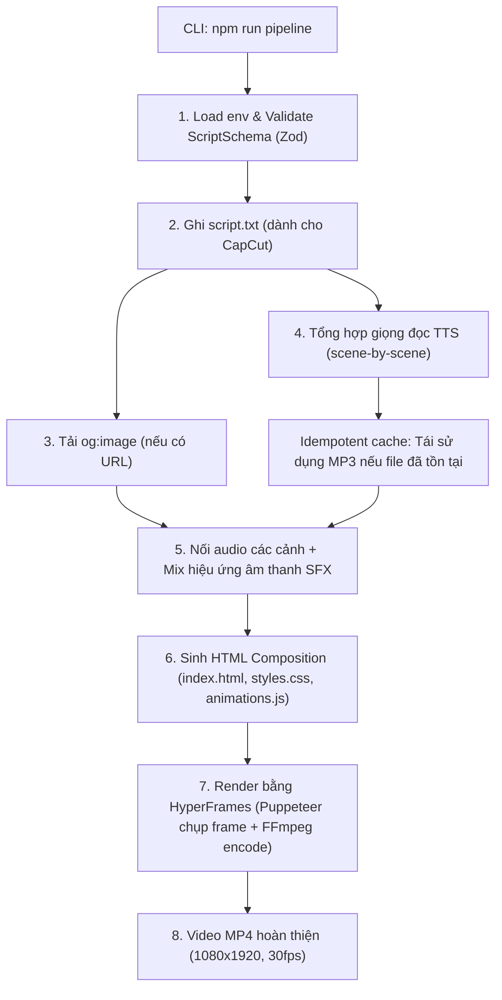

# Báo cáo Audit & Baseline Hiện trạng — Auto_GenVid (M0)

Tài liệu này xác minh hiện trạng thực tế của mã nguồn repo Auto_GenVid theo yêu cầu Milestone M0 trong `PRD2.md`. Mọi kết luận đều dựa trên kiểm tra mã nguồn thực tế và kết quả chạy lệnh.

---

## 1. Sơ đồ luồng thực tế từ mã nguồn

Dưới đây là sơ đồ luồng hoạt động chính của pipeline (`src/pipeline.ts` và `src/cli.ts`):

---

## 2. Danh mục Module trong `src/`

| Module / File | Vai trò và chức năng chính |
|---|---|
| `src/cli.ts` | Điểm vào CLI của lệnh `npm run pipeline -- <path/to/script.json>`. Đọc file và gọi `runPipeline`. |
| `src/pipeline.ts` | Điều phối 8 bước: validate, xuất text, fetch image, TTS, mix audio/SFX, sinh HTML, gọi HyperFrames render. |
| `src/config.ts` | Đọc biến môi trường từ `.env.local` / `.env`, cấu hình TTS providers, tham số TikTok, theme (`dark-neon` / `light-pro`). |
| `src/render/script-schema.ts` | **File schema Zod duy nhất** định nghĩa cấu trúc `ScriptSchema`, 6 `TemplateData`, `Scene`, `SfxSpec`. |
| `src/render/html-composer.ts` | Nhận kịch bản và dữ liệu âm thanh, tạo cây DOM HTML, nhúng timeline GSAP, style CSS theo theme. |
| `src/render/hyperframes-runner.ts` | Gọi CLI `hyperframes` để render composition HTML thành video MP4 qua Puppeteer và FFmpeg. |
| `src/assets/audio-tools.ts` | Các tiện ích xử lý âm thanh bằng FFmpeg/ffprobe: `getDurationSec`, `concatWithSilence`, `mixSfxOntoVoice`. |
| `src/assets/sfx-selector.ts` | Quản lý thư viện SFX, chọn SFX phù hợp theo từng template cảnh (whoosh, ding, pop, spark). |
| `src/assets/image-fetcher.ts` | Tải ảnh đại diện `og:image` từ URL bài viết về thư mục cục bộ. |
| `src/tts/tts-client.ts` | Interface chung `TtsClient` và factory function `createTtsClient(cfg)`. |
| `src/tts/edge-tts-client.ts` | Client Edge TTS miễn phí (`edge-tts-universal` + fallback python `edge-tts`), xuất audio MP3 và SRT. |
| `src/tts/lucylab-client.ts` | Client LucyLab TTS (API key, voice cloning tiếng Việt, tải audio MP3 và phụ đề SRT). |
| `src/tts/elevenlabs-client.ts` | Client ElevenLabs TTS (đa ngôn ngữ, không có SRT). |
| `src/tts/vbee-client.ts` | Client Vbee TTS (giọng đọc tin tức tiếng Việt, polling async, không có SRT). |
| `src/utils/logger.ts` | Format log với màu sắc, timestamp và bước chạy. |
| `src/utils/slug.ts` | Tạo slug URL an toàn từ tiêu đề bài viết. |

---

## 3. Giải quyết 5 điểm mâu thuẫn tài liệu (Đối chiếu với Mã nguồn)

### 3.1. Tên 6 template hiển thị (README vs Mã nguồn)
- **Mâu thuẫn:** `README.md` (dòng 46–51) liệt kê: `breaking-news`, `stat-callout`, `split-screen`, `quote-card`, `listicle`, `big-number`.
- **Thực tế trong code:** Tại [`src/render/script-schema.ts#L5-L61`](file:///home/tho/AUTO_GEN_VIDEO/src/render/script-schema.ts#L5-L61), discriminated union `TemplateData` bao gồm đúng 6 templates sau:
  1. `hook` (tiêu đề giật gân mở đầu)
  2. `comparison` (so sánh 2 bên trái/phải)
  3. `stat-hero` (nhấn mạnh 1 con số lớn kèm nhãn)
  4. `feature-list` (danh sách tính năng dạng gạch đầu dòng)
  5. `callout` (phát biểu/nhận định nổi bật)
  6. `outro` (kêu gọi follow kênh TikTok)
- **Hàm render:** [`src/render/html-composer.ts#L173-L255`](file:///home/tho/AUTO_GEN_VIDEO/src/render/html-composer.ts#L173-L255) cài đặt các hàm `renderHook`, `renderComparison`, `renderStatHero`, `renderFeatureList`, `renderCallout`, `renderOutro`.
- **Kết luận:** Code thật chỉ hỗ trợ 6 template: `hook`, `comparison`, `stat-hero`, `feature-list`, `callout`, `outro`. Danh sách trong `README.md` là tàn dư từ phiên bản cũ chưa cập nhật.

### 3.2. Khả năng xuất phụ đề SRT của các TTS Providers
- **Mâu thuẫn:** `README.full.md` (dòng 441) ghi `scene-hook.srt # SRT subtitle (chỉ khi TTS_PROVIDER=lucylab)`.
- **Thực tế trong code:**
  - `EdgeTtsClient` ([`src/tts/edge-tts-client.ts#L88-L91`](file:///home/tho/AUTO_GEN_VIDEO/src/tts/edge-tts-client.ts#L88-L91)) tạo và ghi file `.srt` nếu `result.subtitle` có dữ liệu. Khi chạy kiểm thử thực tế, Edge TTS đã sinh đầy đủ các file `scene-*.srt`.
  - `LucylabClient` ([`src/tts/lucylab-client.ts#L48-L52`](file:///home/tho/AUTO_GEN_VIDEO/src/tts/lucylab-client.ts#L48-L52)) tải SRT từ server LucyLab về file.
  - `ElevenLabsClient` ([`src/tts/elevenlabs-client.ts#L30`](file:///home/tho/AUTO_GEN_VIDEO/src/tts/elevenlabs-client.ts#L30)) và `VbeeClient` ([`src/tts/vbee-client.ts#L43`](file:///home/tho/AUTO_GEN_VIDEO/src/tts/vbee-client.ts#L43)) bỏ qua tham số `srtOutPath` vì API không hỗ trợ xuất SRT.
- **Kết luận:** Cả **Edge TTS** và **LucyLab** đều xuất được SRT cho từng cảnh. ElevenLabs và Vbee không có SRT. Ghi chú trong `README.full.md:441` là không chính xác.

### 3.3. Đường dẫn file schema (`src/schema.ts` vs `src/render/script-schema.ts`)
- **Mâu thuẫn:** Tài liệu tham chiếu nhắc tới `src/schema.ts`.
- **Thực tế trong code:** Không tồn tại file `src/schema.ts`. Toàn bộ định nghĩa schema kịch bản nằm tại [`src/render/script-schema.ts`](file:///home/tho/AUTO_GEN_VIDEO/src/render/script-schema.ts).
- **Kết luận:** Đường dẫn schema chuẩn và duy nhất là `src/render/script-schema.ts`.

### 3.4. Số lượng Unit Tests (54 vs 60 tests)
- **Mâu thuẫn:** `README.en.md:288` và `README.full.md:291` ghi `npm test # all 54 tests should pass`.
- **Thực tế chạy lệnh:** Chạy `npm test` thực tế bằng Vitest cho kết quả: **11 test files passed, 60 tests passed** (thời gian ~3.8 giây).
- **Kết luận:** Con số 54 là số test cũ. Hiện tại repo có 60 test hoàn toàn xanh.

### 3.5. Nhạc nền (BGM) vs Hiệu ứng âm thanh (SFX)
- **Mâu thuẫn:** `README.md:28` giới thiệu: *"...Voice TTS + Visuals HTML/CSS + Hiệu ứng SFX/BGM..."*.
- **Thực tế trong code:** Toàn bộ `src/` chỉ có module SFX ([`src/assets/sfx-selector.ts`](file:///home/tho/AUTO_GEN_VIDEO/src/assets/sfx-selector.ts)), chưa có bất kỳ dòng code nào xử lý BGM hay ducking nhạc nền.
- **Kết luận:** Repo hiện tại chỉ có SFX. BGM sẽ được phát triển ở Milestone M5 theo đúng đặc tả của `PRD2.md`.

---

## 4. Kết quả chạy Baseline thực tế

### 4.1. Kiểm tra kiểu tĩnh (`npx tsc --noEmit`)
- **Thời gian chạy:** 1.25 giây
- **Kết quả:** Thoát với exit code 0, không có bất kỳ lỗi TypeScript nào.

### 4.2. Chạy toàn bộ Unit Tests (`npm test`)
- **Thời gian chạy:** 3.79 giây
- **Chi tiết:** 11/11 test files passed, 60/60 tests passed.
  - `src/render/html-composer.test.ts`: 2 tests
  - `src/assets/sfx-selector.test.ts`: 9 tests
  - `src/config.test.ts`: 14 tests
  - `src/utils/slug.test.ts`: 5 tests
  - `src/render/script-schema.test.ts`: 6 tests
  - `src/assets/image-fetcher.test.ts`: 4 tests
  - `src/assets/audio-tools.test.ts`: 2 tests
  - `src/tts/edge-tts-client.test.ts`: 3 tests
  - `src/tts/elevenlabs-client.test.ts`: 5 tests
  - `src/tts/lucylab-client.test.ts`: 4 tests
  - `src/tts/vbee-client.test.ts`: 6 tests

### 4.3. Render pipeline mẫu (`npm run pipeline -- output/baseline-test/script.json`)
- **Script đầu vào:** `tests/fixtures/sample-script-no-image.json` (5 cảnh: 1 hook + 3 body + 1 outro).
- **Provider TTS:** Edge TTS (`vi-VN-HoaiMyNeural`).
- **Thời gian thực hiện:**
  - TTS 5 cảnh: ~22 giây (tạo 5 file `.mp3` và 5 file `.srt` trong `output/baseline-test/voice/`).
  - Nối audio + mix SFX: ~1 giây (tạo `voice.mp3` dài 26.93s).
  - HyperFrames frame capture (906 frames, 30fps): ~1 phút 15 giây.
  - FFmpeg video assembly: ~14 giây.
  - Tổng thời gian: ~1 phút 30 giây.
- **Tập tin xuất ra:**
  - `output/baseline-test/video.mp4` (102.1 MB)
  - `output/baseline-test/voice.mp3` (632 KB)
  - `output/baseline-test/script.txt` (478 bytes)
  - `output/baseline-test/voice/*.srt` (5 file phụ đề cho từng cảnh)
- **Kiểm tra thông số kỹ thuật video (`ffprobe`):**
  - **Video stream:** 1080×1920 (chuẩn 9:16), 30 fps, H.264, duration 30.20s.
  - **Audio stream:** AAC stereo, sample rate 48000 Hz, duration 30.19s.
  - Luồng hình và tiếng đồng bộ, hiển thị mượt mà.

